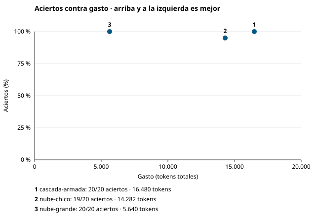

# Lab 1 · Decisión

## 1. Tabla de resultados
(pegar aquí el contenido de resultados/resumen.md)
Configuración	Aciertos	Inválidas	Tokens	Segundos	Costo estimado (USD)
cascada-armada	20/20	        0	    16480	193.3	        0.0
nube-chico	    19/20	        0	    14282	70.2	        0.0
nube-grande 	20/20	        0	    5640	192.2	        0.0

## 2. Gráfico

La configuración 3 (nube-grande) es mejor que las demás, logró 20/20 aciertos con un gasto de 5.640 tokens. 
La cascada-armada tambien logro el 100% de aciertos pero utilizó casi el triple de tokens. Por lo tanto la 
configuracion nube-grande es la mas efectiva y menos costosa.

## 3. Casos importantes

- Reclamo R16: reembolso_pendiente,error_tecnico,baja,0,nube-chico,143,1475,7.59,0.0

## 4. Regla de ruteo de modelos
| Tarea                  | Modelo o configuración |   Por qué se elige |    Riesgo y privacidad |   Cuándo escalar              |

|Clasificación           | nube-grande            |   Mayor precision y|  Riesgo bajo si        |   cuando la confianza del     |
|de reclamos             |                        |   menor coste      |  reclamo no contiene   |   modelo sea baja             |
|                        |                        |                    |  informacion sensible  |                               |

|Clasificacion           | nube-chico             |Obtuvo buen promedio|  Posiblidad de         |  cuando el modelo principal   |
|de respaldo o           |                        |de aciertos 19/20   | errores en la          |  no esté disponible           |
|contigencia             |                        |con consumo         | clasificacion          |                               |
|                        |                        |intermedio de tokens|                        |                               |

|Clasificacion critica   | cascada-armada         | Buena precision    | mayor exposicion de    |   reclamos de alto impacto    |
|                        |                        |                    | datos al usar mas      |                               |
|                        |                        |                    | cantidad de tokens     |                               |

## 5. Lo que el chequeo no verifica

Los resultaods obtenidos no garatnizan el mismo nivel de precision en un entorno con reclaamos mas diversos y complejos. La cantidad de 20 reclamos son pocas para determinar la consistencia de las respuestas a lo largo del tiempo.
